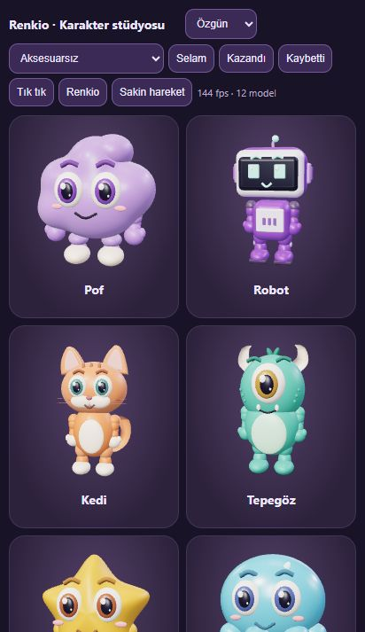

# Character studio v2 — 28 October 2026

Six volumetric toy characters share one model library across profiles, score cards,
the lobby table and the Renkio celebration. Models start without cosmetics. The
existing character IDs, player ownership, purchases and cosmetic slots are retained.

## Model and motion changes

- Rebuilt actor assembly, eyes, face proportions, bodies and attachment geometry.
  Organic actors, the ceramic robot and the jelly have distinct silhouettes.
- Shoulder → elbow → wrist chains, hip → knee chains, articulated ears and tentacle
  tips replace one-piece arms. Head pivots sit at the head rather than the floor.
- Glasses and headwear follow the head. Bow ties follow the neck/body. Multiple
  slots can coexist; headwear has an individual size for each silhouette. The cat's
  smaller headwear fits between the ears. Cloud/star seating offsets keep the hips
  at the same chair height as the taller characters.
- Reauthored idle, greeting, joy, disappointment and secondary joint motion, with
  rest-based sampling and 180 ms quaternion/position transitions. Explicit idle
  cancels a warning; casual taps cannot interrupt or restart outcomes or warnings.
- Existing 4.8 s Renkio timing and 1.78 s contact beat remain shared with the game
  engine. The new joints participate in the contact/celebration pose. The game
  rules, turn blocking and confetti/sound contact timing are retained.
- Three warning contacts project the actual hand through the fixed portrait camera
  so the comic glass mark appears at the hand rather than at a guessed position.
- The rejected frame-exit/stretch code and camera morph were removed from the
  production renderer. The legacy pure frame timeline remains unused; its tests now
  ensure requests cannot stretch or displace a production actor.
- Tile/board DOM changes no longer trigger a full avatar rescan. Existing score
  strip identity caching remains intact. One WebGL context serves all portraits;
  idle drawing is capped near 30 Hz and active gestures near 60 Hz. Offscreen and
  hidden-page behaviour, reduced motion, sound preferences and bounded caches stay
  supported. Reduced motion does not mute an intentional table greeting.
- Character picker header/footer are separate from the scrolling editor, avoiding
  overlap on short phones. No wardrobe or name changes were saved to the original
  local player's profile during manual verification.

## Verification evidence

Automated coverage includes 384 face/colour/loadout combinations with five gesture
samples each, 300 mixed gesture samples per rig followed by exact rest restoration,
transition endpoints, warning projections, drawable geometry and attachment checks,
gesture priorities, high refresh drawing caps, update-bundle integrity and the
existing online/rules/persistence suite. Full-run and final targeted logs are in the
workspace's `work/character-studio-v2-*` files.

Browser verification covered 320×568, 390×844, 412×915 and the normal desktop view.
All six base characters, all six combined glasses/bow/cap and glasses/bow/crown
loadouts, win/lose/contact poses and colour changes were inspected. Mobile picker
scrolling was checked after fixing overlap found during this review.

During real phone-size board interactions, portrait backend node IDs stayed
`13133, 13134` across drag/place/return-to-hand, shuffle, pan and zoom. Two placed
tiles showed the +4 preview and were both returned with Undo; no move was committed
to the original practice game. No experimental frame overlay existed.

An isolated local three-player game tested incoming chat, a committed move, turn
change, returning through Open Games after reload and the final winner screen.
Chat preserved all three portrait backend node IDs (`2168, 2169, 2170`). Browser
error logs were empty in that check. These are browser checks, not measurements from
a physical Android phone; refresh counters in the temporary gallery measure browser
callbacks, not GPU frame rate.

## Release and rollback

Stable starting point: `2624016`, tagged `backup/characters-before-2026-10-28`.
The model changes require no native permission or capability change and use the
existing format-1 Android client updater. Existing installed APKs can receive the
complete verified web revision; no Android signing identity, account or paid plan
is changed by this release.

After deployment, compare all client-bundle file hashes to the committed public
files and check the production health endpoint and actual rendered model version.
If those checks fail, redeploy the prior stable commit; do not mix individual files
from different client revisions.

## Animation references

The implementation uses bounded, authored anticipation/settling and overlapping
joint motion, consistent with [Meta's animation quality guidance](https://developers.meta.com/vr/design/animation/).
The transition approach follows the weight/blend concept described in
[Three.js animation actions](https://threejs.org/docs/pages/AnimationAction.html),
implemented here for deterministic shared procedural rigs rather than external clips.
