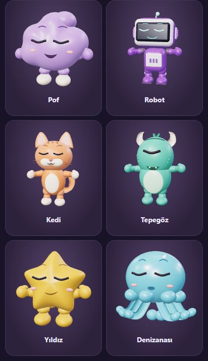

# Facial surfaces and accessory colours

The six mouths are now individual designs: Pof's bean smile, the robot's stepped
display, the cat's muzzle W, the cyclops' wide grin with two teeth, the star's
asymmetric smirk and the jelly's small oval pucker. Eyebrows have individual widths,
curves and expression ranges; the cyclops uses one connected brow.

Mouth and brow vertices, including their expression morph targets, are projected
onto the actual head/muzzle geometry. Their matrices stay attached to the head.
The independent 15 Hz mouth scaling and floating brow transforms are removed.
Expression changes blend geometry through the existing pose transition. During
validation, the cat's surprise expression and the star's angry brow exposed surface
intersections; their anatomy-specific shapes/ranges were corrected.

The bow tie now has bevelled angular fabric wings, fold lines and a rectangular
knot. Glasses, neckwear and headwear each have a separate eight-choice palette.
The avatar's optional `accessoryColors` stores whitelisted `face`, `neck` and `head`
indices; missing/zero values retain original colours. Renderer cache keys, table
seat identity, DOM artwork and persisted profile normalization include the colours.
Existing avatars, ownership and accessory toggling remain compatible.

Validation: 187 tests passed. New tests cover six distinct facial geometries,
intermediate expression samples staying on the skin, fixed facial transforms,
morph transition endpoints and safe colour serialization. Browser checks covered
the six expressions and the angular bow tie. In the isolated local Studio C test
profile, blue glasses / coral bow / gold cap were saved, reopened and confirmed in
the persisted profile as `{face:2, neck:3, head:5}`. The original local and live user
profiles were not edited for that check. This is a format-1 web update compatible
with the installed Android updater; it introduces no native capability changes.
